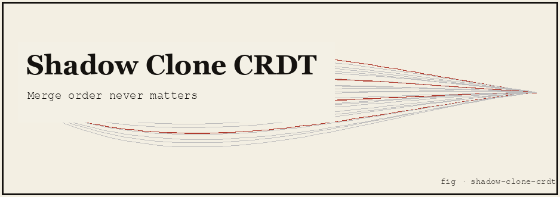

# Shadow Clone CRDT

**Naruto's Shadow Clone Jutsu (Kage Bunshin no Jutsu), implemented as a real, state-based CRDT replication system: clones train concurrently on independent copies of a shared memory, and dispelling them back into the original converges to the same final state no matter what order they pop in, or if the same clone accidentally dispels twice.**

Concept & reference: the manga/anime trope that a ninja can spawn autonomous clones, send them off to train or scout independently, and have their experience "come back" to the original the instant each clone is dispelled — safely, regardless of order. This project does not animate chakra or clones; it implements the actual mathematics that would have to be true for that trope to be *safe*: **Conflict-free Replicated Data Types** (CRDTs), as formalized by Shapiro, Preguiça, Baquero and Zawirski, *"Conflict-free Replicated Data Types"* (INRIA, 2011). A state-based CRDT's `Merge` operation forms a **join-semilattice** — commutative, associative, idempotent — and those three laws alone are what guarantee **Strong Eventual Consistency**: replicas that have seen the same updates converge to the same state, in any order, any number of times.

---

## TL;DR

- Five real CRDTs make up a clone's replicated `Memory`: `GCounter` (training reps), `PNCounter` (net chakra), `GSet` (jutsu learned), `ORSet` (scrolls carried, add-wins), `LWWRegister` (latest status). Their product is itself a join-semilattice.
- `Army.Spawn` runs clones as **real goroutines**, each on its own deep-copied `Memory` snapshot and its own private `*rand.Rand` — no shared mutable state between clones, so there is nothing for `go test -race` to catch.
- `Army.Dispel` merges clone results into the original. Property tests prove, over hundreds of random cases, that `Merge` is commutative, associative, and idempotent — so dispel order never matters and double-dispel is a safe no-op.
- **Chakra is a real, finite budget.** You cannot spawn more clones than it affords; `Spawn` fails atomically (no partial spend) when it would.
- Pure Go, **zero third-party dependencies**, **21 tests, all pass under `-race`**, ~62% statement coverage (the untested remainder is `main.go`'s print-heavy demo trace).

```bash
go test -race -cover ./...   # 21 tests, race-clean
go run .                     # the demo trace below
```

---

## The idea

In the manga, a Shadow Clone is a fully autonomous copy of the user that can fight, scout, or train on its own. The famous training application: have ten clones each spend an hour drilling a technique, dispel them all, and the original instantly has ten hours of practice — *regardless of which clone dispels first*, and without any clone's hour overwriting another's. That "regardless of order" clause is doing all the interesting work, and it is exactly the problem distributed systems call **state-based replica convergence**.

If each clone's experience were just "the original's state, overwritten by whichever clone dispels last," training with clones would be *useless* — nine of the ten clones' hours would be thrown away depending on dispel order. The manga's implicit promise is stronger: *every* clone's contribution survives, *no matter the order*. That promise has a name and a precise mathematical characterization: a **state-based CRDT (CvRDT)**, whose merge function is a **join** in a semilattice.

---

## The honest core

A type `T` with an operation `Merge: T × T → T` is a valid CvRDT payload exactly when, for all `a, b, c : T`:

```
commutative:  a.Merge(b)          == b.Merge(a)
associative:  a.Merge(b).Merge(c) == a.Merge(b.Merge(c))
idempotent:   a.Merge(a)          == a
```

These three laws say precisely: **the result of merging any set of updates does not depend on the order you apply them in, or on how many times a particular update is re-applied.** That is Strong Eventual Consistency (Shapiro et al., 2011, Theorem 1), and it is exactly the "clones can dispel in any order, and an accidental double-dispel is harmless" property the manga assumes but never explains. This project implements five standard CRDTs that each satisfy the laws, composes them into one product type, and backs every claim with randomized property tests that actually check the three equations above — not just a few hand-picked examples.

### The five CRDTs (`Memory`'s components)

| Field | Type | What it models | Merge rule |
|---|---|---|---|
| `Reps` | `GCounter` | training reps drilled, per clone | pointwise max per replica slot |
| `Chakra` | `PNCounter` | net chakra: gained − spent | two `GCounter`s (gain ledger, spend ledger) merged independently |
| `Jutsu` | `GSet` | jutsu names drilled to muscle memory | set union |
| `Scrolls` | `ORSet` | scrolls currently carried (can be picked up *and* dropped) | add-wins observed-remove: union of add-tags, union of remove-tags |
| `Status` | `LWWRegister` | latest self-reported training status | highest `(logical clock, replica id)` wins |

- **`GCounter`** (`gcounter.go`) only grows. Each replica (clone) may increment only its own slot, so taking the pointwise max of two counters can never lose an increment either side has already recorded — that is what makes max a safe merge.
- **`PNCounter`** (`pncounter.go`) adds decrements honestly: instead of one counter that can go down (which breaks the grow-only argument), it holds *two* `GCounter`s — chakra gained and chakra spent — and reports `Value() = P.Value() - N.Value()`, which **can** go negative (a clone in chakra debt), unlike either underlying `GCounter`.
- **`GSet`** (`gset.go`) is a grow-only set: once a jutsu is drilled, it is never "un-drilled," so union is lossless.
- **`ORSet`** (`orset.go`) is the one real subtlety: **scrolls can be dropped**, and a naive "delete wins" merge is not safe under concurrency — if clone A drops a scroll while clone B concurrently picks up its own fresh copy of the same scroll, a delete-wins merge would lose B's pickup. The add-wins Observed-Remove Set (Shapiro et al. §3.3.2) fixes this by tagging every `Add` with a globally-unique id and having `Remove` tombstone only the tags it has actually *observed* — a concurrent add the remover hasn't seen yet survives the merge. `TestORSetAddWinsConcurrentRemove` in `crdt_test.go` is exactly this scenario, built and checked directly.
- **`LWWRegister`** (`lwwregister.go`) picks a winner by comparing `(Counter, ReplicaID)` lexicographically. It deliberately does **not** use `time.Now()`: wall-clock time is not a true total order (ties happen, clocks skew), which would make merges non-deterministic and tests flaky. A Lamport-style logical clock plus a unique replica id *is* a true total order, so the register's merge is always deterministic. (See Limitations for the one precondition this relies on.)

### `Memory`: the composite (`memory.go`)

`Memory.Merge` merges each of the five fields independently. This is the standard CRDT composition result: **the Cartesian product of join-semilattices, merged componentwise, is itself a join-semilattice** — each of the three laws holds for the product because it holds in each coordinate independently. `memory_test.go` checks this empirically on the composite type, not just on the five parts in isolation.

### What is real vs. simulated

| Aspect | Status |
|---|---|
| The five CRDTs and their join-semilattice laws (commutative/associative/idempotent `Merge`) | **Real**, implemented exactly per Shapiro et al. (2011), property-tested with hundreds of random cases |
| `Army.Spawn` running clones as concurrent goroutines, each with its own memory, race-free by construction | **Real** Go concurrency — `go test -race` exercises it directly |
| Dispel-order independence / double-dispel idempotency | **Real** consequence of the laws above, demonstrated both algebraically (random `a,b,c` triples) and end-to-end (real spawned clones, shuffled merge orders) |
| "Chakra," "jutsu," "scrolls," clone "memory" | **Simulated** — integers, strings, and set elements standing in for fictional concepts. No chakra, clones, or ninja techniques are real; see Limitations |
| A clone "learning" or "remembering" anything | **Not cognitive** — `LearnJutsu` adds a string to a `GSet`. There is no model of skill, memory, or training efficacy, only bookkeeping |

---

## How it works

### File map (single `main` package)

```
shadow-clone-crdt/
├── go.mod           # module shadow-clone-crdt, Go 1.24.4, no deps
├── lattice.go        # the CRDT[T] contract + compile-time conformance checks
├── gcounter.go        # grow-only counter (training reps)
├── pncounter.go        # inc/dec counter built from two GCounters (chakra)
├── gset.go            # grow-only set (jutsu learned)
├── orset.go           # add-wins observed-remove set (scrolls carried)
├── lwwregister.go      # last-writer-wins register, logical-clock tiebreak (status)
├── memory.go          # the product CRDT combining all five
├── clone.go           # CloneCtx: a clone's private workspace + mutation API
├── army.go            # Army: chakra budget, Spawn (goroutines), Dispel (merge)
├── main.go            # the demo trace
├── crdt_test.go        # join-semilattice law property tests, per CRDT
├── memory_test.go      # join-semilattice laws + order-independence on Memory
└── army_test.go        # concurrency, chakra budget, end-to-end dispel tests
```

### Key types

- **`CRDT[T]`** (`lattice.go`): the `Merge`/`Clone` contract every type below satisfies, with compile-time assertions (`var _ CRDT[GCounter] = GCounter{}`, etc.) that each concrete type actually implements it with the right self-referencing type parameter.
- **`CloneCtx`** (`clone.go`): a clone's private workspace. Starts as a deep copy of a `Memory` snapshot; exposes `Train`, `GainChakra`, `SpendChakra`, `LearnJutsu`, `PickUpScroll`, `DropScroll`, `ReportStatus`. Mints its own globally-unique `ORSet` tags (`"<cloneID>#<n>"`, a private counter) and its own logical clock ticks — no coordination with any other clone is ever required for uniqueness.
- **`Army`** (`army.go`): "the original." Owns the canonical `Memory` and a finite chakra budget. `Spawn(n, chakraPerClone, seeds, work)` launches `n` real goroutines, each working on an independent snapshot and its own `*rand.Rand`; `Dispel(results...)` merges any number of results, in any order, into the original.

### Why the concurrency is actually safe

`Army.Spawn` hands each goroutine a **deep copy** of the original's memory and a **private** `*rand.Rand`; goroutines write only to their own slot of the `results` slice. No goroutine ever reads or writes another goroutine's data, or the `Army`'s own fields, while clones are running — state moves between goroutines only as **values**, at spawn (snapshot in) and at dispel (result out), never as shared mutable memory. That is an actor-style design, not a "the race detector didn't find anything yet" accident, and `go test -race` is run on every test in this project to check it.

---

## Install & run

Requires **Go 1.24+** (developed on `go1.27.2`, targets `go1.24.4`). No third-party dependencies.

```bash
cd shadow-clone-crdt
go build ./...              # compile
go run .                    # run the demo trace
go test ./...                # run the test suite
go test -race -cover ./...   # race detector + coverage
```

### Captured sample output (`go run .`, deterministic — reproduced exactly on every run)

```
Shadow Clone CRDT -- Kage Bunshin no Jutsu as a state-based CRDT
Every clone trains independently. Dispel order never matters.
====================================================================

Original spawned with 600 chakra.
--------------------------------------------------------------------
1) Spawn 5 clones (100 chakra each = 500) -- concurrent training
--------------------------------------------------------------------
  chakra left after wave 1: 100
  clone-w1-0     reps=29   chakra=26   jutsu=leaf-whirlwind   scrolls=(none)                   status="drilling basics"
  clone-w1-1     reps=41   chakra=22   jutsu=shuriken-combo   scrolls=(none)                   status="exhausted, resting"
  clone-w1-2     reps=48   chakra=27   jutsu=tree-walking     scrolls=summoning-scroll         status="exhausted, resting"
  clone-w1-3     reps=58   chakra=32   jutsu=kawarimi         scrolls=(none)                   status="sparring"
  clone-w1-4     reps=33   chakra=10   jutsu=leaf-whirlwind   scrolls=summoning-scroll         status="refining form"
--------------------------------------------------------------------
2) Dispel the wave in three different random orders
--------------------------------------------------------------------
  trial 1: shuffled dispel order -> reps total 209, jutsu learned 4
  trial 2: shuffled dispel order -> reps total 209, jutsu learned 4
  trial 3: shuffled dispel order -> reps total 209, jutsu learned 4
  all 3 shuffled-order merges produced an identical Memory value: true
  dispelled wave 1 into the original (in spawn order).
--------------------------------------------------------------------
3) Accidentally dispel the same wave a second time
--------------------------------------------------------------------
  state unchanged by the duplicate dispel: true
--------------------------------------------------------------------
4) Try to spawn more clones than remaining chakra allows
--------------------------------------------------------------------
  chakra left: 100
  Spawn(4, 100, ...): spawn: not enough chakra for 4 clones at 100 each: need 400, have 100
  spawned+dispelled 1 more clones with the remaining chakra; chakra left: 0
--------------------------------------------------------------------
Final memory of the original, after every clone dispelled
--------------------------------------------------------------------
original
  reps total:     268
  net chakra:     144
  jutsu learned:  kawarimi, leaf-whirlwind, shuriken-combo, tree-walking
  scrolls held:   summoning-scroll
  status:         "exhausted, resting" (clock 1, set by clone-w2-0)

No clone ever wrote to another clone's memory, and the original
never had to merge results in spawn order on purpose -- yet the
final state is the same regardless of merge order, because
Memory.Merge is commutative, associative, and idempotent. That
is the whole trick, and it is real math, not a narrative device.
```

### Reading the trace

Watch step 2: the exact same five clone results, merged in three independently-shuffled orders, produce **identical** reps totals, jutsu counts, and (checked via `reflect.DeepEqual`) identical full `Memory` values. Step 3 dispels the same wave again by accident and nothing changes. Step 4 shows chakra is a hard, non-decorative constraint: a wave that would overspend it is rejected atomically, with the budget untouched, and only a wave that fits is allowed through.

---

## Testing

```bash
go test ./...
go test -race -cover ./...
```

**21 tests, all pass under `-race`**, **~62% statement coverage** of the whole package (untested remainder is `main.go`'s print-heavy demo trace; every CRDT, `Memory`, and `Army` method is at or near 100%).

What they verify:

- **`TestJoinSemilatticeLaws`** (`crdt_test.go`) — table-driven, 200 random trials per type, for `GCounter`, `PNCounter`, `GSet`, `ORSet`, `LWWRegister`: `Merge` is commutative, associative, and idempotent.
- **`TestMemoryIsAJoinSemilattice`** (`memory_test.go`) — the same three laws, checked on the five-field product type, with states built by replaying random operations through a real `CloneCtx`.
- **`TestMemoryMergeOrderIndependent`** / **`TestDispelOrderIndependentAcrossRealWaves`** — build clone memories (one via direct construction, one via real spawned goroutines against a live `Army`), merge them in 50–100 independently shuffled orders, and assert every order converges to the identical `Memory`.
- **`TestMemoryDoubleDispelIsNoOp`** / **`TestDoubleDispelOnRealArmyIsNoOp`** — dispelling the same result twice (or three times) is identical to dispelling it once.
- **`TestORSetAddWinsConcurrentRemove`** — the specific add-wins scenario: a concurrent add not yet observed by a remove survives the merge; a *sequentially observed* remove does take effect.
- **`TestSpawnEachCloneWritesOnlyItsOwnSlot`** — before any dispel, no clone's result contains another clone's contribution (proof clones never see each other's writes).
- **`TestChakraBudgetEnforced`** / **`TestChakraNotDeductedOnFailedSpawn`** — the chakra budget is enforced exactly, and a failed `Spawn` never partially spends it.
- **`TestGCounterValueIsSumOfReplicaMaxes`**, **`TestPNCounterCanGoNegative`**, **`TestGSetAddIsIdempotentOnValue`**, **`TestLWWRegisterHigherCounterWins`**, **`TestLWWRegisterTiesBreakOnReplicaID`**, and more — direct, hand-computed checks of each type's semantics.

The full suite runs clean under the race detector (`go test -race`), including the real-goroutine tests in `army_test.go`.

### A real bug the property tests caught

`GCounter.Increment(replica, 0)` originally wrote a zero-valued map entry for `replica` even when incrementing by zero (Go's `map[k] += 0` on an absent key inserts `k`). Two semantically-identical counters (same `Value()`, same real per-replica contributions) could end up with different underlying map representations — one with a stray zero entry, one without — which made `reflect.DeepEqual` see them as unequal and broke the commutativity test for any random sequence that happened to include a zero-sized increment. `TestJoinSemilatticeLaws/PNCounter` and `/LWWRegister`-adjacent `TestMemoryIsAJoinSemilattice` caught this immediately. Fixed by making `n == 0` a true no-op in `Increment` (`gcounter.go`) rather than writing a representational artifact that happened to be semantically zero.

---

## Limitations & honest caveats

- **`LWWRegister` requires globally-unique write tags.** The `(Counter, ReplicaID)` tiebreak is only a valid total order if no two causally-independent writes ever share the same pair — which holds here because every clone's `ID` is unique per spawn and its logical clock only increases locally. If two *different* logical writers were ever assigned the same `ReplicaID`, their writes could collide and the "winner" would be an arbitrary, ambiguous choice. This is a standard, documented precondition of LWW-Registers in the literature, not a workaround specific to this project.
- **No real chakra, clones, or ninjutsu.** "Chakra" is a `uint64` budget; "training" is incrementing counters and adding strings to sets; "clones" are goroutines with a private struct. Nothing here models skill, cognition, or combat.
- **No network, no persistence, no partial failure.** This is an in-process simulation: all "replicas" live in one Go process's memory. A real distributed CRDT deployment has to handle message loss, partial replication, and crash-recovery, none of which are modeled here — the project's claim is about the *merge algebra*, not about building a distributed system.
- **`uint64`/`int64` counters, not arbitrary precision.** A sufficiently long-running simulation could overflow; the demo's values stay far below any such boundary.
- **The "jutsu/scroll/status" vocabulary is illustrative**, not a faithful catalog of anything from the source material — it exists to give each CRDT a concrete, readable use.

---

## References

- Shapiro, Preguiça, Baquero, Zawirski, *"Conflict-free Replicated Data Types"* (INRIA, 2011) — https://inria.hal.science/inria-00609399/document
- Shapiro, Preguiça, Baquero, Zawirski, *"A comprehensive study of Convergent and Commutative Replicated Data Types"* (INRIA Research Report, 2011) — https://inria.hal.science/inria-00555588/document
- Join-semilattice — https://en.wikipedia.org/wiki/Semilattice
- Strong eventual consistency — https://en.wikipedia.org/wiki/Eventual_consistency#Strong_eventual_consistency
- Lamport, *"Time, Clocks, and the Ordering of Events in a Distributed System"* (1978) — https://lamport.azurewebsites.net/pubs/time-clocks.pdf
